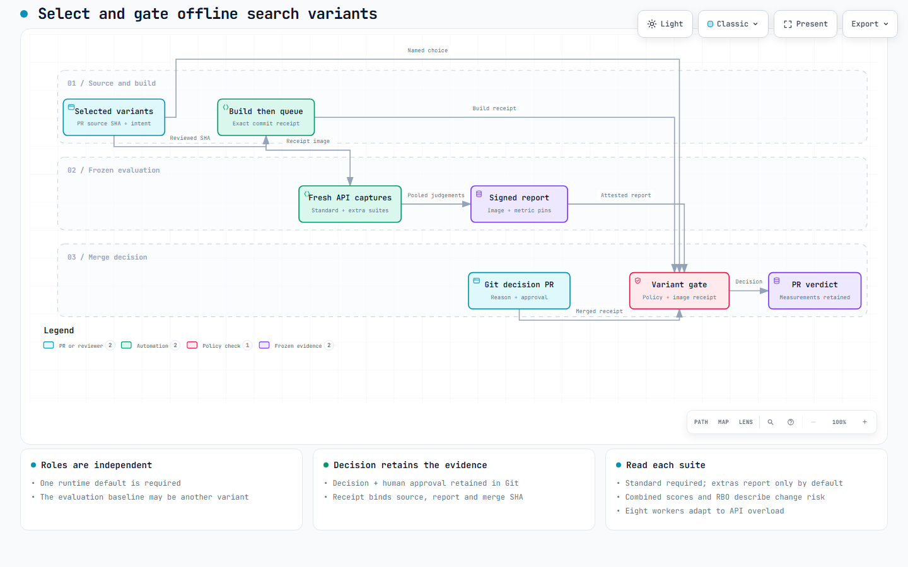
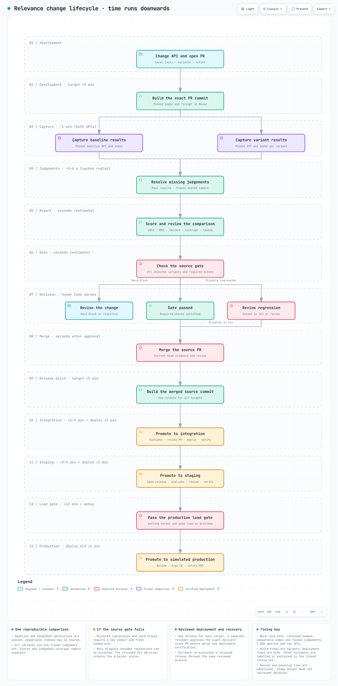
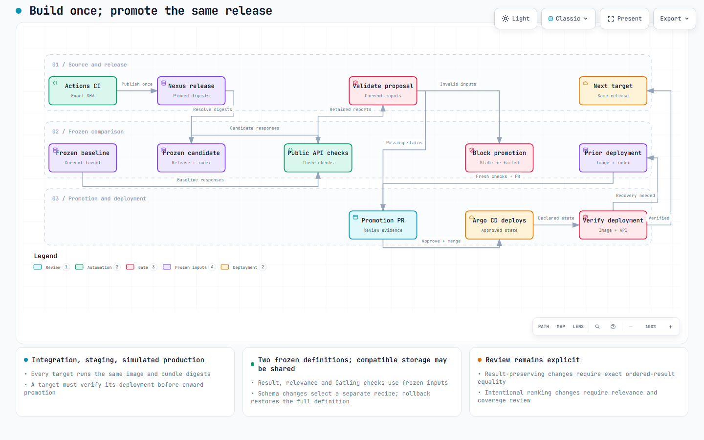

# Build, promote and roll back a release

Develop the Search API in `delivery-source`. Actions builds it and the coordinator
compares its results with the baseline. After source merge, promote the new build
through integration, staging and simulated production. Argo CD deploys reviewed
state; the coordinator checks the image, index and public API.

The lab's remote workflow is installed; see [current status](plans/roadmap.md)
for remaining validation. Developers do not need a kubeconfig. Operators install and repair
the lab using [control runtime](control-runtime.md).

## Relevance change lifecycle

[Open the interactive timeline](diagrams/interactive/relevance-sdlc.html).
Each promotion follows its own evidence gate. Integration and staging use short
performance probes; simulated production requires the normal/peak load check,
then compares its active API with the prepared candidate before the route switch.
Read from top to bottom; spacing shows sequence, not elapsed time.
Stage timings cover warm runs only, with reused judgements and a compatible index.
Review and queueing time are additional. See the [timing sources and boundaries](plans/relevance-sdlc-diagram.md#timing-sources-and-boundaries).
The source gate checks the PR commit. Deployment uses a separate build of the
merged commit, promoted unchanged through three reviewed targets.

## Make and evaluate a change

1. In `delivery-source`, create a branch, change the API or ranking settings and
   run its application tests. The [source contributors guide](../lab/delivery/bootstrap/README.md#contributors-guide)
   includes a copyable query rewrite and test.
2. Declare variants and intent in `gate/selection.json`. Use `ranking-change`
   for intentional changes, or `preserve-results` for a release expected to
   return the same products in the same order. `gate/evaluation.json` names the
   baseline and default; `configurations/` contains their settings.
   Fresh repositories select `ranker-a` with `preserve-results`. If the selection
   file is absent in an older repository, create it using the example in the
   [source gate guide](../lab/delivery/bootstrap/gate/README.md#prepare-your-pr)
   and commit it on your PR branch before pushing.
3. Push and open a PR. **Reference release CI** builds its exact commit and stores
   the image, bundle and receipt in Nexus. **Offline relevance gate** submits
   a comparison; its completion alone is not a relevance verdict.
4. Open the PR comment's storefront and report links. Review relevance, label
   coverage and changed results using the [variant guide](variant-evaluation.md).
   Add report-only queries for your change, or explicitly require a labelled set.
5. Wait for `relevance-lab/merge-gate` on the current head. Every new commit needs
   fresh evidence. A bounded exception uses the [Git decision procedure](variant-evaluation.md#accept-a-bounded-regression) without changing
   scores; invalid evidence and hard blocks cannot be approved away.
6. Merge when the required checks pass. CI builds the merged commit separately.
   Use that successful run for deployment, rather than the PR-head build.

Changes confined to the two source README paths receive the
[documentation exemption](relevance-gate.md); tests and builds still run.
Source repositories default to no required approvals for the lab, while setup
preserves stricter existing rules. Deployment proposals require a separate reviewer.

## Follow a release

Open [Release dashboard](https://control.localhost:34443/release-dashboard) and
sign in with your lab identity. Search or filter the release cards, then choose
**View release tree**. The selected build URL can be bookmarked or shared with
another authorised lab user.

The tree follows source merge through Integration, Staging, the inactive
production candidate and active production. Attached records show the source
gate at merge, build outcome, saved check results, current proposal review and
deployment verification. **Merged** means the proposal merged; **Verified**
means its exact release has a matching deployment receipt and ready rollout.
**Prepared** means the inactive production slot is ready. It does not switch
the active route. **Previously verified** identifies a historical deployment.

Use **Inputs & policy** for pinned inputs and the source gate configuration;
**Activity** shows attempts and durations. Use **Progress** while an operation is
running and **View result** after it completes, fails or is interrupted.
In **Deployed environments**, use **Open storefront** beside a ready environment
to open its current release; production links follow the active route or named
inactive slot. The current active
production release is shown alongside the selected release. The page refreshes
every 30 seconds while visible. Refreshing reads records without starting work
or extending leases. Administrators can submit the named operations below;
readers see the same tree with unavailable controls and an explanation.

### Promote from the release tree

1. Select the successful merged-source build. Choose an environment node in the
   tree, or use **Stage** in **Promotion controls**.
2. [Suggest, review and record the release check plan](release-check-plans.md).
   Then choose **Check and propose Integration** or **Check and propose Staging**.
   The coordinator uses source-fixed variants and the recorded release intents. It checks every selected variant separately against
   the target's current default API configuration. The report pins that baseline
   build, variant and configuration hash. Staging requires this exact release to be
   currently verified in Integration. Follow **Open progress and review links**.
   Each action shows its planned comparison immediately above the button: the
   candidate build and variants, their individual intents and the current target
   baseline's build, default variant and configuration hash. Changing **Stage**
   changes that baseline. Rollback shows the retained release as its candidate;
   candidate preparation explains that its comparison happens at the release check.
3. Open the promotion report and **Review proposal in Gitea**. The report identifies
   the current target and candidate by linked build number, available version and
   variant name. Review each variant's intent, nDCG change, result overlap,
   judgement coverage and measured performance budgets. Missing summaries are
   labelled unavailable; open the detailed reports before approving. Full hashes
   remain under **Evidence details**. Review the proposal, then approve the exact PR
   head. Select it under **Approved proposal**, then choose **Deploy approved
   proposal**. The coordinator rechecks the approval and evidence, merges the
   desired state, waits for Argo CD and verifies the API.
4. After verified Staging, select **Production candidate** and choose **Prepare
   production candidate**. Approve and deploy its preparation proposal using
   the same controls. Active production continues serving its current release.
5. Select **Active production**, then **Check and request production release**.
   This runs the normal and peak load gate and the final comparison against
   active production. Review, approve and deploy the route-switch proposal.
6. For rollback, choose **Check and request rollback** on the active release.
   A different, ready and previously verified release must exist in the other
   slot. Review and deploy the rollback proposal separately.

The panel pins the selected build and observed environment definitions. If a
release, target or reviewed head changes before queued work executes, the
operation fails with a refresh instruction; it cannot silently deploy a different
release. Retrying the same submission retains its durable operation. After a
failed or interrupted operation, inspect its progress before choosing **Submit a
new attempt**. The existing Actions workflows and production release page remain
available.

**Customise the next comparison** links to the selected source commit’s variants,
query-set selection and gate policy. These inputs are frozen for this release.
The source fixes candidate variants and configurations. Review a release check
plan against the destination baseline to select the cumulative release intents
and additional checks. The approved plan is recorded in delivery-state without
rebuilding. See the [plan walkthrough](release-check-plans.md).
Every promotion runs the catalogue's configured standard query sets (one or
more). Every standard set is required. A custom primary manifest cannot replace
the group; put custom queries in
`additional_query_sets` in source `gate/selection.json`. The reviewed plan
accumulates these declarations, including removed or superseded sets.
The same named sets are checked for every selected candidate variant against
one target baseline. Required sets have separate blocking outcomes; report-only
sets remain informational, including when their capture or scoring fails.
The report groups **Standard query sets** and **Additional query sets**, with
separate measurements for each set and an informational combined view.
Combined averages never decide promotion. See [additional query sets](variant-evaluation.md#add-queries-for-your-change).

The release dashboard lists the selected variants and each declared change
intent from the recorded plan, marks the default variant and links to that
build's exact selection file. Source declarations supply the initial suggestions.
The Production release page shows the same list for its prepared candidate.

Unknown records are shown explicitly. The dashboard reads recent source runs
and operations plus retained verification history; it is not a complete archive
of every source PR. Older production checks without a recorded release identity
appear separately. A missing gate record does not imply a passing gate.

## Preview or compare manually

The **Environments** view shows each delivery environment's next promotion:
previews to Integration, Integration to Staging, and Staging or the inactive
production slot to active Production. **Ready** describes a serving API;
the promotion badge describes the evidence and review for that next move.

| Badge | Meaning |
| --- | --- |
| Grey | No matching evidence, unavailable evidence, an already deployed release, or unknown source order |
| Red | Recorded promotion checks are incomplete, approval is pending, or the proposal or target changed |
| Orange | The reviewed release is promotable, but its semantic version precedes the target |
| Green | The reviewed release is promotable and its semantic version follows the target |

Version order uses SemVer when both releases have a recorded version. Build
metadata does not affect precedence. Git ancestry remains visible and provides
the fallback for retained unversioned releases. Equal versions and unavailable
ordering stay neutral. See [version a release](delivery-versioning.md). This
read-only status does not replace the coordinator's deployment checks. A
passing source gate alone does not satisfy a subsequent promotion gate.
Production preparation alone does not satisfy the final release gate.

To end a preview or ephemeral environment before its lease expires, choose
**Expire now** on its card and confirm. Ephemeral environments use the normal
deletion path. Delivery preview expiry requires a human lab administrator,
is queued through the coordinator and shows **Follow expiry progress** beside
the button. The expiry operation ends the lease; the normal cleanup loop then
removes the deployment. A running comparison blocks early expiry, and a
changed preview lease requires you to refresh before trying again.

Reports and the shared catalogue are retained. Integration, Staging and both
Production slots have no expiry control and are rejected by the preview expiry
API. Use the reviewed deployment or rollback workflow to change them.

In `delivery-source` → **Actions**, choose **Create preview** or **Compare builds**,
then **Run workflow** on **main**. Supply the successful build run ID
from its `/actions/runs/<id>` URL; compare also needs a baseline run.

The workflow prints a durable progress URL and releases the runner. Follow that
record to completion and open the returned storefront or report.

The release dashboard distinguishes **New attempt** from **Existing attempt**.
Reopening an existing attempt starts no new checks. Its original submission time
and recorded error remain visible. The primary control reflects the selected
stage's latest attempt:

| Current state | Primary control | Result |
| --- | --- | --- |
| No earlier attempt | **Check and propose Integration** (or the selected stage's action) | Submit checks |
| Queued or running | **View progress** | Open the existing attempt |
| Failed or interrupted | **Run checks again** | Submit a fresh attempt using current settings; retain the previous result |
| Open proposal | **Review proposal** | Open its Gitea review |

The latest attempt's outcome and link remain beside the control. Preconditions
and access checks can disable an action. Repeating a submission after a network failure reuses the
same attempt to avoid duplicate work.

Browser links show a readable progress page with the current stage and outcome.
Report pages separate relevance,
result overlap and judgement coverage. The recorded merge gate appears at the
top; a passed gate needs no relevance decision. The PR offers a decision link only
when a bounded decision is required. An old decision link for a passed gate
also shows that no decision is needed. Timings distinguish elapsed time since
submission (including waiting) from each search capture Job. Capture requests
are functional checks; their retry counts do not constitute a load test. Gatling
reports show workload duration, latency, failed requests and phase budgets.
Under **Native Gatling reports**, open **View baseline Gatling report** or
**View candidate Gatling report** for the driver's complete charts and request
statistics in a new tab. **Download baseline ZIP** and **Download candidate ZIP**
retain the HTML report and supporting files for offline inspection. These links
also appear for completed drivers whose measurements failed the performance
gate. A driver that did not retain an archive is labelled unavailable. Report
access uses the operation's permissions and verifies the retained archive hash;
viewing it does not start another test.
Promotion and rollback progress pages link to all three retained checks. After
deployment, the verification report shows the release, index, products checked
and verification duration. RBO and Jaccard compare each variant with
the baseline; relevance scores are shown per variant. Delivery evidence links to each
retained check. Use **View JSON data** for the underlying record. **Submitted**
does not mean evaluated or deployed. Both comparison revisions must contain the
current evaluation/configuration contract.

New desired-state proposals, deployment definitions, production slot records and
history JSON use two-space indentation for readable Gitea diffs. Fingerprints and
immutable release/evidence artefacts retain canonical encoding. Formatting a
proposal changes its Git commit, so any existing approval must be renewed for
the new head even when the JSON values are unchanged.

For workstation commands and retry behaviour, see [remote delivery](remote-delivery.md).
Both paths call the same coordinator; neither requires kubectl.

## Promote a merged release

The three targets share one cluster. They are separate deployment namespaces,
not separate failure domains or performance-isolated systems.

1. Select the successful merged-source build and Integration in the dashboard.
   [Review and record its check plan](release-check-plans.md), then choose
   **Check and propose Integration** (or use the existing Actions workflow).
   The coordinator reads source-fixed variants and the reviewed release intents. It evaluates every selected
   variant separately against the target's current default build/configuration.
   The lab uses `esci-gb-v1`.
2. Follow the operation to its `delivery-state` PR. The coordinator first
   evaluates the candidate against the target, then proposes the pinned release.
   A failed evaluation cannot create a valid promotion.
3. Review the evidence and wait for `delivery/validation`. A permitted reviewer
   must approve the exact PR head. Approval does not deploy it.
4. Run **Deploy approved promotion** with that **desired-state PR number**.
   The coordinator rechecks the proposal and approval, merges it, then waits for
   Argo CD and the public API. The operation must finish with `state: verified`.
5. Run **Promote to staging**, then repeat review and deployment using the
   **same merged build** and frozen inputs. First review a separate plan
   against the current Staging baseline.
   Each preceding target must be verified first. No image is rebuilt.
6. Use the [production release UI](https://control.localhost:34443/production-release)
   for the final release, as described below.

If desired-state main or the target baseline changes, create a fresh proposal.
Evidence must match the exact inputs, recorded plan and per-variant release intents and be no more
than three days old. A merged source PR has already passed its per-variant merge
gate, including any individually approved bounded exception. Promotion reports
still show each variant's fresh target comparison.
A merge without successful deployment verification is not a completed promotion.
Use `verify` with the target to recheck after an operator repairs a failed deployment.

| Target | Gatling profile | Required evidence |
| --- | --- | --- |
| Integration / staging | `probe` | 20 s warm-up, 30 s measurement at 2 requests/s per API |
| Simulated production | `production-load` | One minute warmup, five minutes at 10 requests/s and fifteen minutes at 20 requests/s, for each release |

The production **load gate** runs sequentially against temporary baseline/candidate
previews. The additional final relevance check calls the active production API
and prepared candidate slot directly. The two load runs take at least 42 minutes
plus setup; the final relevance check adds capture, resolution and scoring time.
Both runs must complete every scheduled arrival and satisfy the pinned
[workload](../lab/traffic/production-load-v1.json). Normal-load budgets are
p95 ≤250 ms and p99 ≤500 ms; peak budgets are p95 ≤400 ms and p99 ≤800 ms.
Both phases require fewer than 1% failed requests. These are lab thresholds,
not production capacity claims. Probes, smoke checks and stress tests cannot
replace this gate. Validation checks the load evidence again before merge.

## Release to production

Blue–green deployment keeps two API releases available. The production URL
selects one slot; preparing the other slot does not change that route.

1. Open **Production release** from the control UI. Compare active production
   with the prepared candidate: build, source commit, image, catalogue and index.
   Candidate values stay blank until preparation is deployed. Select **Prepare
   production candidate** to use the verified staging release. If staging matches
   active production, promote a different release to staging first.
2. Follow the operation to its preparation PR. Approve the exact head in Gitea,
   then select it under **Deploy an approved PR**. Only open production PRs
   approved at their current commit appear; use **Refresh status** after approval.
3. Review and record a Production check plan against active production and the
   deployed inactive candidate. Select **Check and release production**. The
   coordinator uses the pinned variants and reviewed release intents, runs the
   existing full gates including normal/peak Gatling load, then compares each
   candidate variant with the same active production build and default
   configuration.
4. Open the final production comparison from the friendly report. Check nDCG,
   its change and significance, RBO/Jaccard, coverage and judgement resolution
   outcomes. Both releases use one frozen set of labels.
5. Review and approve the route-switch PR in Gitea. Use **Deploy an approved PR**
   and select that approved PR. Wait for deployment verification and open active production.

The final check uses up to 1,000 queries from the pinned ESCI suite as a
**simulated recent-traffic fixture**. It does not claim to reproduce yesterday's
traffic. The baseline calls the stable active service; the candidate calls its
separate slot service. Their catalogue, concrete index, mapping and request
context must match. Elasticsearch's write block represents paused catalogue
updates and is checked before and after evaluation and before activation.

The final report adds human-reviewed evidence; it does not introduce a new nDCG
threshold or qualify model predictions. Missing scores, abstentions and errors
remain visible. Existing delivery gates still apply. Changed slots or stale
final evidence require a fresh check. Both slots remain deployed after switching.

Use **Request rollback to the other slot** to re-evaluate the retained release
and create a reviewed rollback PR. A subsequent candidate preparation replaces
that inactive slot, so the one-step retained rollback covers the last switch.
Older releases remain in Git history and can use the separate historical restore
workflow.

## Roll back

For production, use **Request rollback to the other slot** in the release UI.
The Actions steps below apply to integration and staging.

1. Find the previous verified fingerprint under
   `delivery-state/history/<target>/`. Its retained definition pins the old
   image, configuration, inputs and index recipe.
2. Run **Request rollback** with the target and fingerprint. The coordinator
   requires a reviewed plan for the retained release against active production
   and checks each selected
   variant against the current target default configuration.
   The coordinator evaluates **current → previous** and creates a new PR.
   Reversing an old report is insufficient. Production rollback uses the full
   `production-load` profile too.
3. Review, approve and run `merge-reviewed` as for promotion. A historical schema
   uses its retained index recipe; it cannot silently use the latest mapping.

## Artefacts and administration

| Repository or store | Contents |
| --- | --- |
| `delivery-source` | API/UI, tests, ranking settings, index contract and Actions workflows |
| `delivery-state` | Reviewed target definitions, relevance decisions, proposals and deployment history |
| Nexus | Digest-pinned images, deterministic bundles, build receipts and signed merge evidence |
| `search-spike` / `environment-state` | Separate leased experiment workflow in the control UI |

Operators bootstrap empty targets, install the coordinator, manage credentials
and recover failed resources. See [control runtime](control-runtime.md) and
[activation](plans/walkthrough-activation.md). Previews expire after 72 hours;
stable targets do not. Removing a preview retains its source and frozen evidence.

For GitHub Enterprise, retain the shared Actions syntax and frozen contracts,
replace provider-specific repository/run/PR/status calls, and configure runner
credentials and protection. Local Gitea execution does not establish GHES compatibility.
See [dated delivery evidence](research/evidence/promotion-deployment.md) and
[remaining native/cloud checks](plans/native-cloud-validation.md).

## Follow queued and running work

The production release page lists queued and active delivery work. Submission
feedback appears beside the button used. Repeated candidate preparation for the
same verified staging release and active production reuses its operation and PR,
including from another browser tab. Refresh before preparing a changed release.

The progress page shows the queue position and the active blocker. Expand
**Live logs** for timestamped steps and operation results. **Pause** stops log
updates and scrolling; **Resume** continues from the same cursor. Only bounded,
operation-scoped messages are shown; raw subprocess output is kept out of this
view. Missing logs do not prevent status or report access.

During functional evaluation, **Evaluation progress** groups related phases by
API preparation, query set/check and performance handover. Each query-set group
shows capture, judgement resolution and scoring as separate steps when relevant.
Worker startup, sampled capture counts and capture completion share one capture
step. Scoring and significance calculation share one scoring step. Expand
**Phase details** for the earlier updates; these remain available after refreshes.
Capture updates show completed queries, query failures, retries and pacing wait.
For each selected variant, required standard functional checks are validated
first, followed by the declared standard/additional query sets. Gatling starts
only after those required checks pass. Report-only sets remain informational.
An earlier required failure retains its reports and marks performance as not run.
A completed query has finished capture across its selected APIs or returned an
error. Workers publish bounded counters; the coordinator and page sample them
every five seconds, so short phases may finish between updates.
The capture summary uses its final count after **Capture complete** is reported.
An earlier sample such as 841/1,000 is retained in the details, rather than shown
as a separate unfinished phase. Without a final capture event, the display keeps
the sampled count and explicitly says the final count was not reported. This
never substitutes for completeness validation in the retained report. Counts for
scoring describe its captured inputs; judgement counters use query–product pairs.

**Waiting for Kubernetes Job status** means the coordinator cannot currently
read the capture Job's status. After three consecutive failed reads, the check
stops with a Kubernetes-access error rather than implying the worker is still
running. Each status/log command is bounded to ten seconds. Missing log samples
do not prevent a successfully completed Job from being recognised.

Judgement resolution shows its phase and completed batch counts where available.
A synchronous service call may report **Waiting for judgement batch** until it
returns; the page does not invent per-pair progress or a completion estimate.
The panel retains its timestamp across browser refreshes. If the coordinator
cannot read a fresh worker sample, it labels the displayed counters as last known.
Counters are provisional; final reports and gates still require complete,
validated evidence. Query text, product IDs and raw worker output are not
forwarded into the progress panel.

If a variant check fails, the operation error includes its concrete retained
reason, such as which side missed a performance budget. The report repeats that
reason beside the variant. Review it before deciding whether to retry; a failed
check never becomes a pass because a live counter reached its total.

During a Gatling check, live driver counters show the side, phase, completed
requests, failures and mean latency. These are provisional. Job elapsed time
includes startup; planned traffic time does not. The retained report supplies
the gate's workload validity, percentiles and outcome. A failed check links its
evidence and identifies a missed side, phase and threshold when available.
Later missing samples retain the last known counters and show **Finalising
driver**, rather than returning to **Starting driver**. An incomplete driver run
cannot satisfy the gate.

Humans approve delivery-state PRs but cannot directly merge them. Use **Deploy
approved promotion** or the production release UI. Only the coordinator may
merge to delivery-state main after revalidation; source PRs use normal merging.

The observability link uses minute-aligned boundaries and two minutes of padding
around the observed run, allowing metric exports to become visible. Probe and
evaluation panels show probe traffic separately from normal search SLOs. Their
counts can include warm-up and neighbouring probes; the retained Gatling report
supplies the exact measured phases and gate outcome.

The live Gatling panel links to SigNoz with the tested search environment and
the padded run window selected. Search panels use that environment filter;
operation panels remain lab-wide. Keep the installed dashboard aligned with
the source-controlled definition. No data is not evidence that a check passed.
